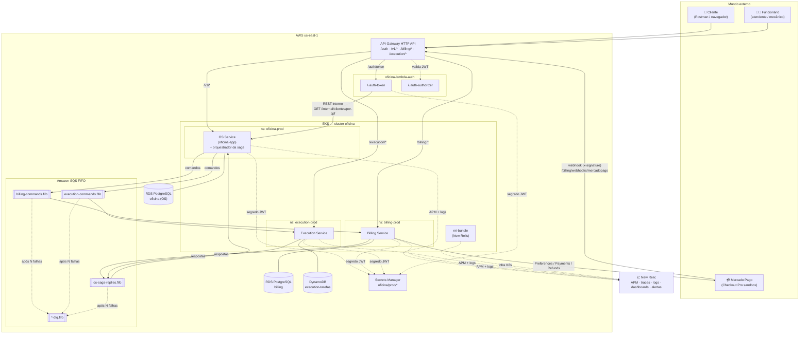
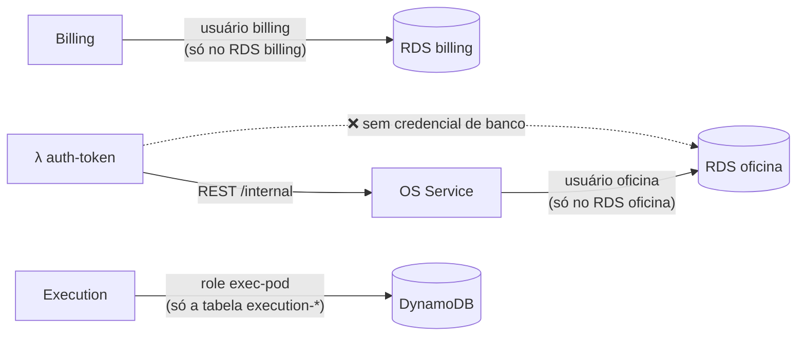
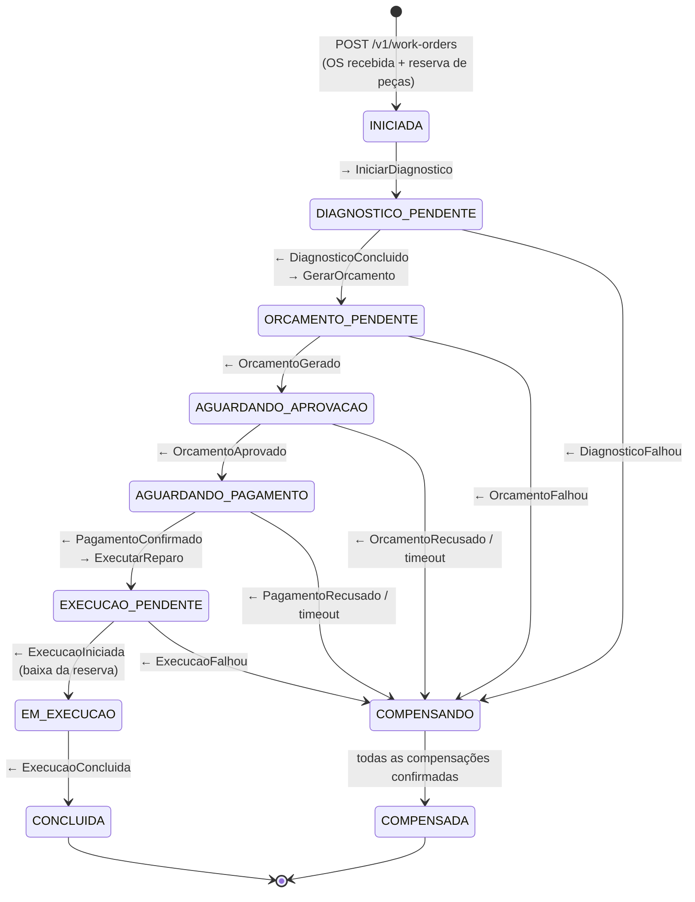
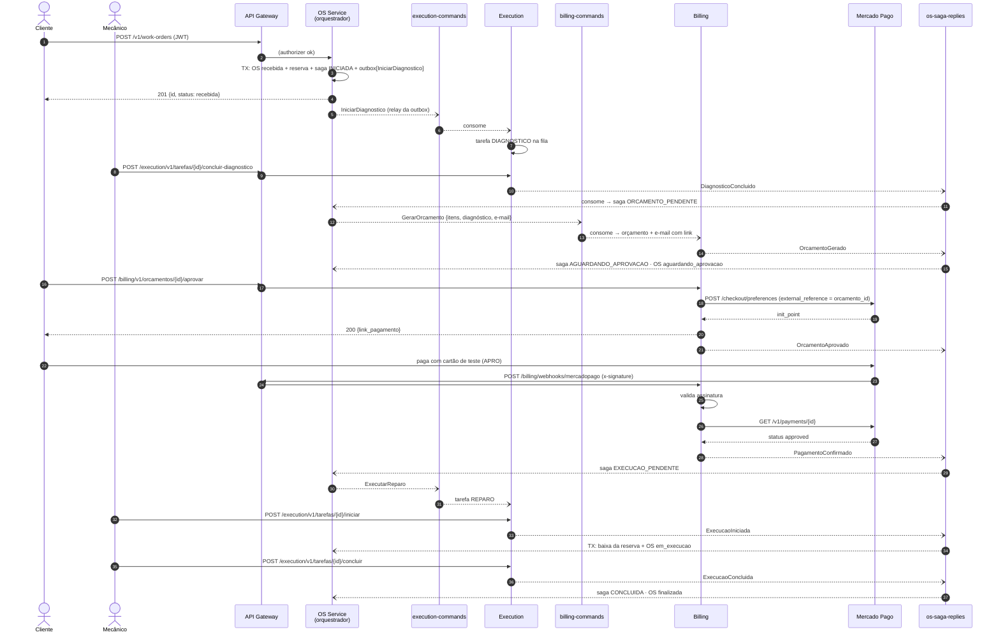
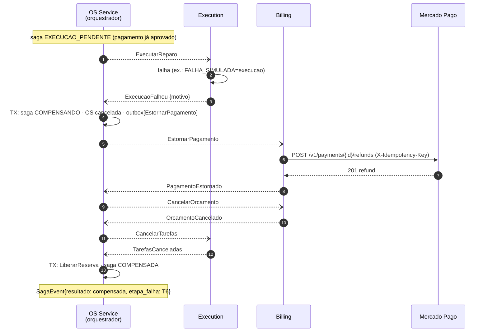
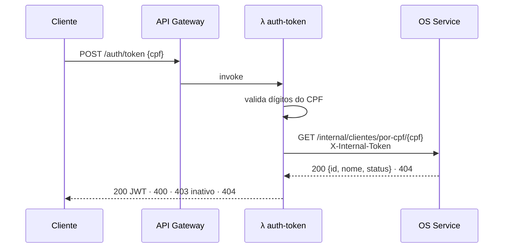
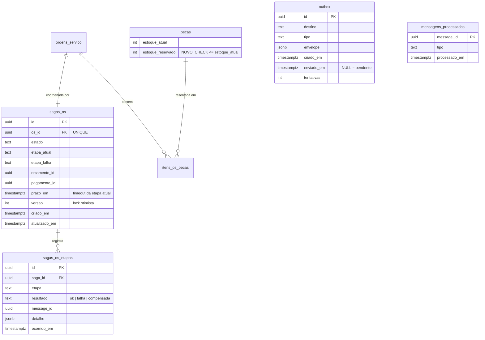
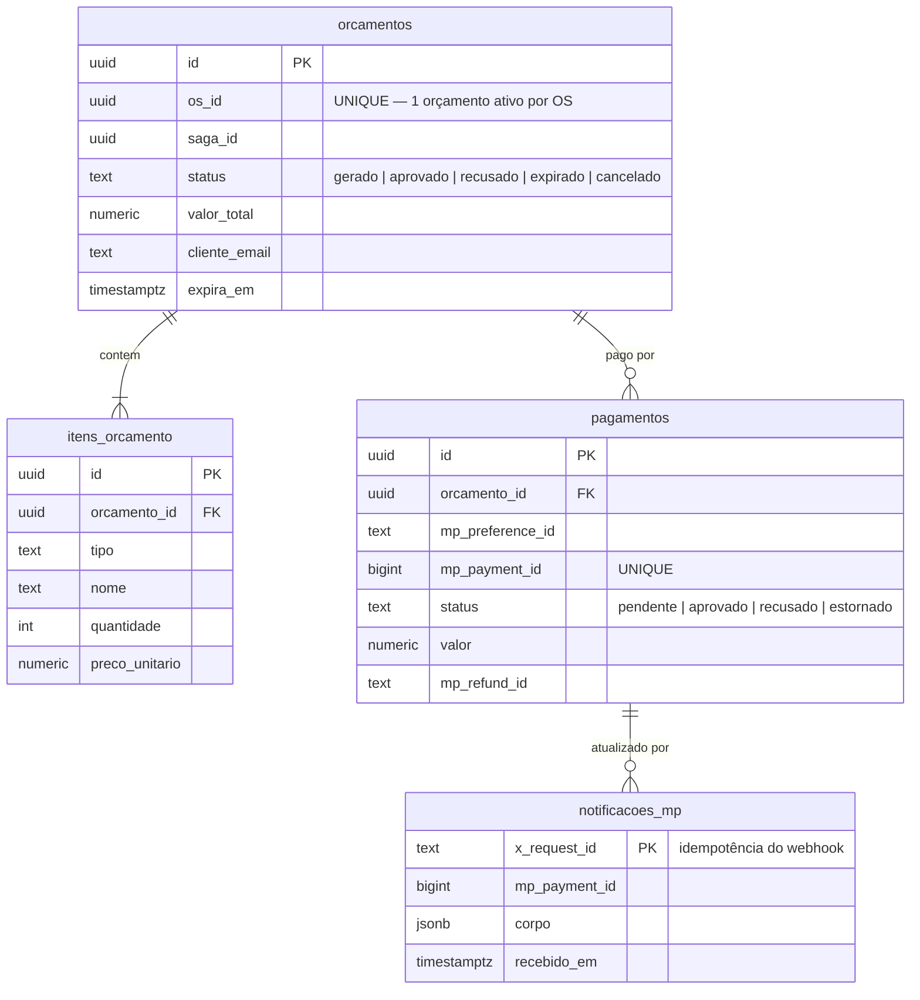
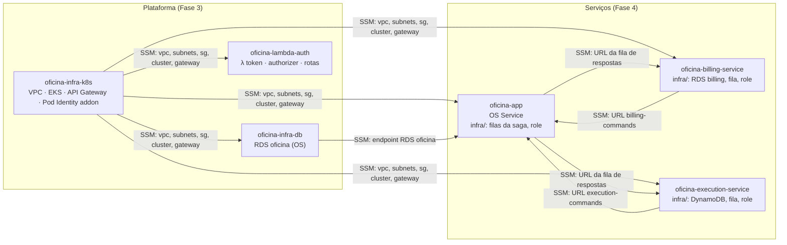

# Arquitetura-alvo — Fase 4

> Arquitetura de microsserviços da oficina, com saga orquestrada pelo OS Service sobre SQS FIFO. Os diagramas abaixo são a base do "diagrama geral da arquitetura final" pedido no PDF — **revise-os contra o que foi realmente implantado** antes de exportar (F4-8.4).

---

## 1. Diagrama de componentes



### Responsabilidade de cada componente

| Componente | Responsabilidade | Dados que possui | Não faz |
|---|---|---|---|
| **OS Service** (`oficina-app`) | Atendimento (clientes, veículos), catálogo, estoque com **reserva**, ciclo de vida da OS, histórico, relatórios, login de funcionário e **orquestração da saga** | `clientes`, `veiculos`, `usuarios`, `servicos`, `pecas`, `ordens_servico`, `historicos_status`, `sagas_os`, `outbox`, `mensagens_processadas` | Não calcula orçamento, não fala com o Mercado Pago, não gerencia fila de mecânicos |
| **Billing Service** | Orçamento (geração, envio, aprovação/recusa, expiração), cobrança no Mercado Pago, verificação e estorno de pagamento | `orcamentos`, `itens_orcamento`, `pagamentos`, `notificacoes_mp`, `outbox`, `mensagens_processadas` | Não muda status de OS — **responde** ao orquestrador |
| **Execution Service** | Fila de execução, tarefas de diagnóstico e reparo, atribuição a mecânico, cancelamento | Tabela `execution-tarefas` (tarefas + outbox + inbox no mesmo design de chave única) | Não conhece preço nem pagamento |
| **λ auth-token / authorizer** | Emitir e validar o JWT do cliente por CPF (Fase 3) | — (consulta o OS Service por REST) | **Não lê mais o RDS** |
| **SQS FIFO** | Transporte de comandos e respostas da saga, ordenado por `saga_id` | — | — |
| **New Relic** | APM dos 3 serviços, traces distribuídos atravessando as filas, logs, `SagaEvent`, dashboards, alertas | — | — |

---

## 2. Posse de dados e regra de isolamento



Como a regra é **provada** (e mostrada no vídeo/PDF):

| Isolamento | Mecanismo |
|---|---|
| Billing não lê o banco do OS | Instância RDS separada, senha em segredo próprio (`oficina/prod/billing-db`), SG do RDS billing só aceita o SG dos nós, e o pod não tem a senha do outro |
| OS não lê o banco do Billing | Idem, simétrico |
| Execution só acessa a própria tabela | Policy da role do Pod Identity: `dynamodb:*Item`, `Query` e `TransactWriteItems` apenas em `arn:...:table/execution-tarefas*` |
| Cada serviço só consome a própria fila | Policy: `sqs:ReceiveMessage`/`DeleteMessage` só na fila de comandos do serviço; `sqs:SendMessage` só na fila de respostas |
| Lambda sem banco | Removidos o SG de acesso ao RDS e o campo DSN do segredo da Lambda |

---

## 3. Saga da ordem de serviço

### 3.1 Estratégia: orquestrada

O **orquestrador** é um componente do OS Service (`internal/application/saga`), não um serviço à parte. Ele:

- persiste o estado da saga em `sagas_os` **na mesma transação** em que muda a OS e grava na `outbox`;
- envia **comandos** para a fila de cada serviço e consome **respostas** da fila `os-saga-replies.fifo`;
- decide a próxima etapa ou, em caso de falha, executa as **compensações em ordem inversa** das etapas já concluídas;
- trata **timeouts** (orçamento sem resposta, pagamento não confirmado) com um *watchdog* periódico.

Por que não coreografia — resumo para o README (a argumentação completa vai na RFC-006):

| Critério | Orquestrada | Coreografada |
|---|---|---|
| Onde está o fluxo | Uma máquina de estados, um arquivo | Implícito, espalhado nos *handlers* dos 3 serviços |
| Quem decide compensar | O orquestrador, com a lista de etapas concluídas na mão | Cada serviço precisa ouvir os eventos de falha dos outros |
| Estado de uma OS "no meio do caminho" | `SELECT * FROM sagas_os WHERE os_id = ...` | Reconstruir a partir de eventos em 3 bancos |
| Espera humana (aprovação/pagamento) com timeout | Natural: estado + prazo | Quem é dono do timer? |
| Acoplamento | OS conhece os comandos dos outros | Cada serviço conhece os eventos dos outros |
| Escala de fluxos | Pior com dezenas de participantes | Melhor |

Com **3 participantes, um fluxo linear e uma espera humana**, a orquestração ganha em todos os critérios que importam aqui. O custo assumido — o OS Service conhece o contrato de comandos dos outros dois — fica explícito no catálogo abaixo.

### 3.2 Máquina de estados da saga



Correspondência com o status visível da OS (o que o cliente vê em `GET /v1/work-orders/{id}/status`):

| Estado da saga | Status da OS |
|---|---|
| `INICIADA`, `DIAGNOSTICO_PENDENTE` | `recebida` → `em_diagnostico` (quando o Execution responde `DiagnosticoIniciado`, evento informativo) |
| `ORCAMENTO_PENDENTE`, `AGUARDANDO_APROVACAO`, `AGUARDANDO_PAGAMENTO` | `aguardando_aprovacao` |
| `EXECUCAO_PENDENTE`, `EM_EXECUCAO` | `em_execucao` |
| `CONCLUIDA` | `finalizada` (→ `entregue` pelo PATCH manual do atendente) |
| `COMPENSANDO`, `COMPENSADA` | `cancelada` (**novo**) |

### 3.3 Etapas e compensações

| # | Etapa | Serviço | Ação | Compensação |
|---|---|---|---|---|
| T1 | Abrir OS e reservar peças | OS (local) | `ordens_servico` + `pecas.estoque_reservado += n` | `LiberarReserva` (local) |
| T2 | Diagnóstico | Execution | Tarefa `DIAGNOSTICO` na fila | `CancelarTarefas` |
| T3 | Orçamento | Billing | Orçamento a partir dos itens + diagnóstico; e-mail com link | `CancelarOrcamento` |
| T4 | Aprovação | Billing (humano) | Cliente aprova → cria preference no Mercado Pago | (coberta por T3) |
| T5 | Pagamento | Billing (Mercado Pago) | Webhook → `GET /v1/payments/{id}` = `approved` | `EstornarPagamento` (refund) |
| T6 | Reparo | Execution | Tarefa `REPARO`; ao iniciar, OS baixa a reserva | `CancelarTarefas` + `DevolverEstoque` |
| T7 | Conclusão | Execution → OS | OS `finalizada` | — (pivô: depois daqui não se compensa, só se corrige) |

| Falha em | Compensações executadas (ordem inversa) | Resultado |
|---|---|---|
| T1 — peça sem saldo para reservar | — (a transação local não comita) | `422`, nenhuma saga criada |
| T2 — Execution rejeita (ex.: fila fechada) | `LiberarReserva` | OS `cancelada` |
| T3 — Billing não consegue gerar | `CancelarTarefas` → `LiberarReserva` | OS `cancelada` |
| T4 — **cliente recusa** ou prazo expira | `CancelarOrcamento` → `CancelarTarefas` → `LiberarReserva` | OS `cancelada` |
| T5 — **pagamento recusado** (cartão `OTHE`) ou prazo expira | `CancelarOrcamento` → `CancelarTarefas` → `LiberarReserva` | OS `cancelada` |
| T6 — **falha ao iniciar o reparo** | `EstornarPagamento` → `CancelarOrcamento` → `CancelarTarefas` → `LiberarReserva` | OS `cancelada`, refund no MP |

> **Compensação também falha.** Um `EstornarPagamento` pode receber 5xx do Mercado Pago. Compensações são comandos como quaisquer outros: idempotentes, reentregues pelo SQS até `maxReceiveCount`, e depois vão para a DLQ — que dispara alerta (F4-7.4). A saga fica em `COMPENSANDO` e o *watchdog* a reporta como presa. **Nunca** marque `COMPENSADA` sem a confirmação de todas.

---

## 4. Diagramas de sequência

### 4.1 Caminho feliz



### 4.2 Compensação — falha ao iniciar o reparo (a cena do vídeo)



### 4.3 Autenticação por CPF (mudança em relação à Fase 3)



---

## 5. Contrato de mensagens

### 5.1 Envelope (igual em todas as filas)

```json
{
  "message_id": "7f9d0b8e-…",
  "tipo": "GerarOrcamento",
  "versao": 1,
  "saga_id": "c1b0…",
  "os_id": "a3e2…",
  "correlation_id": "req-…",
  "ocorrido_em": "2026-11-10T14:03:22Z",
  "origem": "os-service",
  "payload": { }
}
```

| Atributo SQS | Valor | Para quê |
|---|---|---|
| `MessageGroupId` | `saga_id` | Ordem garantida dentro de uma saga; sagas diferentes em paralelo |
| `MessageDeduplicationId` | `message_id` | Deduplicação de 5 min no FIFO (a de longo prazo é o inbox) |
| `MessageAttributes.newrelic` / `traceparent` / `tracestate` | cabeçalhos de DT | Trace distribuído atravessando a fila (F4-7.1) |
| `MessageAttributes.tipo` | `tipo` | Roteamento no consumidor sem desserializar o corpo |

### 5.2 Catálogo

| Mensagem | Tipo | De → Para | Fila | Payload mínimo |
|---|---|---|---|---|
| `IniciarDiagnostico` | comando | OS → Execution | `execution-commands.fifo` | `numero_os`, `veiculo{placa,modelo}`, `descricao` |
| `DiagnosticoIniciado` | resposta (info) | Execution → OS | `os-saga-replies.fifo` | `tarefa_id`, `mecanico` |
| `DiagnosticoConcluido` | resposta | Execution → OS | `os-saga-replies.fifo` | `tarefa_id`, `diagnostico` |
| `DiagnosticoFalhou` | resposta | Execution → OS | `os-saga-replies.fifo` | `motivo` |
| `GerarOrcamento` | comando | OS → Billing | `billing-commands.fifo` | `itens[{tipo,ref,nome,qtd,preco}]`, `diagnostico`, `cliente{nome,email}` |
| `OrcamentoGerado` | resposta | Billing → OS | `os-saga-replies.fifo` | `orcamento_id`, `valor_total`, `expira_em` |
| `OrcamentoFalhou` | resposta | Billing → OS | `os-saga-replies.fifo` | `motivo` |
| `OrcamentoAprovado` | resposta | Billing → OS | `os-saga-replies.fifo` | `orcamento_id`, `link_pagamento` |
| `OrcamentoRecusado` | resposta | Billing → OS | `os-saga-replies.fifo` | `orcamento_id`, `motivo` |
| `PagamentoConfirmado` | resposta | Billing → OS | `os-saga-replies.fifo` | `pagamento_id`, `mp_payment_id`, `valor` |
| `PagamentoRecusado` | resposta | Billing → OS | `os-saga-replies.fifo` | `mp_status_detail` |
| `ExecutarReparo` | comando | OS → Execution | `execution-commands.fifo` | `itens`, `diagnostico` |
| `ExecucaoIniciada` | resposta | Execution → OS | `os-saga-replies.fifo` | `tarefa_id`, `iniciado_em` |
| `ExecucaoFalhou` | resposta | Execution → OS | `os-saga-replies.fifo` | `motivo` |
| `ExecucaoConcluida` | resposta | Execution → OS | `os-saga-replies.fifo` | `tarefa_id`, `finalizado_em` |
| `EstornarPagamento` | compensação | OS → Billing | `billing-commands.fifo` | `motivo` |
| `PagamentoEstornado` | resposta | Billing → OS | `os-saga-replies.fifo` | `refund_id` |
| `CancelarOrcamento` | compensação | OS → Billing | `billing-commands.fifo` | `motivo` |
| `OrcamentoCancelado` | resposta | Billing → OS | `os-saga-replies.fifo` | — |
| `CancelarTarefas` | compensação | OS → Execution | `execution-commands.fifo` | `motivo` |
| `TarefasCanceladas` | resposta | Execution → OS | `os-saga-replies.fifo` | `quantidade` |

Regras do contrato:

- **Compatibilidade:** campo novo é opcional; remover/renomear campo exige `versao` nova e consumidor aceitando as duas por um deploy.
- **Payload autossuficiente:** o comando leva o que o destino precisa (preço, e-mail, placa). Billing **não** pergunta ao OS o preço de uma peça — isso seria acoplamento síncrono no meio da saga.
- **Respostas a comandos de compensação são obrigatórias**, mesmo quando não havia nada a desfazer (`TarefasCanceladas{quantidade: 0}`) — é assim que o orquestrador sabe que pode marcar `COMPENSADA`.
- **Fonte da verdade:** `docs/mensagens/` no `oficina-app` (JSON Schema por tipo), copiado para os testes de contrato dos outros dois repos (F4-5.3).

---

## 6. Modelo de dados por serviço

### 6.1 OS Service — mudanças sobre o modelo da Fase 3



E em `status_ordens`: novo registro `cancelada`; em `ordens_servico`: `cancelado_em timestamptz`, `motivo_cancelamento text`.

### 6.2 Billing Service (PostgreSQL)



Valores monetários em `numeric(12,2)` — o OS Service ainda usa `float64` no domínio, e o Billing é onde arredondamento vira bug de dinheiro (ver F4-2.1).

### 6.3 Execution Service (DynamoDB, *single-table*)

| Item | `pk` | `sk` | Atributos | GSI1 (`gsi1pk` / `gsi1sk`) |
|---|---|---|---|---|
| Tarefa | `OS#<os_id>` | `TAREFA#<tipo>#<tarefa_id>` | `estado`, `mecanico`, `diagnostico`, `iniciado_em`, `finalizado_em`, `saga_id` | `FILA#<tipo>#<estado>` / `<prioridade>#<criado_em>` |
| Inbox | `MSG#<message_id>` | `MSG` | `processado_em`, `ttl` (7 dias) | — |
| Outbox | `OUTBOX#<id>` | `OUTBOX` | `envelope`, `destino` | `OUTBOX#PENDENTE` / `<criado_em>` (*sparse*: removido ao enviar) |

- **Próxima tarefa da fila:** `Query GSI1 gsi1pk = FILA#REPARO#AGUARDANDO`, `ScanIndexForward = true`, `Limit 1`.
- **Atribuir ao mecânico sem corrida:** `UpdateItem` com `ConditionExpression estado = :aguardando`.
- **Efeito + inbox + outbox atômicos:** um `TransactWriteItems` com `Put` inbox (`attribute_not_exists(pk)`), `Update` tarefa e `Put` outbox.

---

## 7. Topologia dos repositórios



**Ordem de `apply` do zero:** `infra-k8s → infra-db → (oficina-app/infra ∥ billing/infra ∥ execution/infra) → lambda-auth → deploys`.

> **Armadilha de dependência circular.** Cada serviço é dono da fila **de entrada** (OS: respostas; Billing e Execution: comandos), mas precisa **enviar** para a fila do outro. Se a permissão de envio for escrita como *queue policy* citando a role do outro repo, o OS precisa da role do Billing e o Billing precisa da role do OS — dois `apply` cruzados. Evite com duas convenções: (1) a permissão de envio é *identity policy* na role do **remetente**, apontando para o ARN da fila **por nome convencionado** (`arn:aws:sqs:us-east-1:<conta>:billing-commands.fifo`) — IAM aceita ARN de recurso que ainda não existe; (2) a **URL** da fila é lida da SSM pelo CD no deploy, não pelo Terraform. Assim os três `infra/` aplicam em qualquer ordem. Ver [F4-4.1](backlog.md#f4-41--filas-sqs-fifo-dlq-e-contrato-ssm).

### Estrutura de cada repositório de serviço

```
oficina-<servico>/
├── cmd/api/main.go             # HTTP + consumidor SQS + relay da outbox (goroutines)
├── internal/
│   ├── domain/                 # entidades e regras puras
│   ├── application/usecase/    # casos de uso (portas)
│   ├── application/saga/       # (só no OS) orquestrador
│   └── infra/
│       ├── http/               # handlers gerados pelo oapi-codegen + middleware JWT
│       ├── mensageria/         # envelope, publisher SQS, consumer, outbox relay, inbox
│       ├── repository/         # Postgres ou DynamoDB
│       └── observability/      # New Relic
├── docs/openapi.yaml · docs/arquitetura.md
├── features/                   # (só no OS) BDD godog
├── k8s/base · k8s/overlays/prod
├── infra/                      # Terraform dos recursos do serviço
├── Dockerfile · docker-compose.yml
└── .github/workflows/ ci.yml · security.yml · cd.yml · terraform.yml
```
