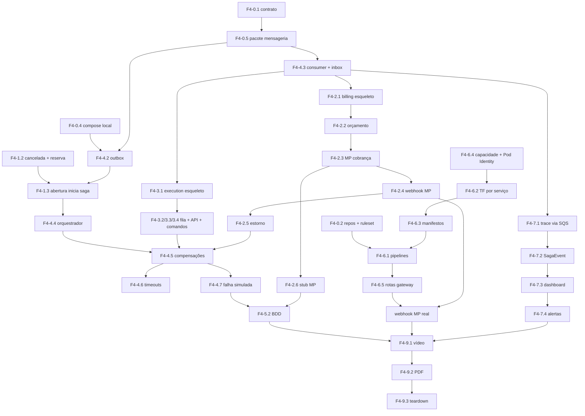

# Roadmap — Tech Challenge Fase 4

Sequência de execução, dependências, riscos e controle de custo. As tarefas referenciam os IDs de [backlog.md](backlog.md). O cronograma diário está no [plano de execução](plano-execucao.md).

> ⏱️ **As sprints abaixo são a referência do "jeito certo com tempo" (~18 dias).** O que será executado é o [plano de 4 dias](plano-execucao.md) (ter 10/11 → sex 13/11, replanejado em 10/11), que comprime estas sprints em 3 trilhas paralelas e aplica os cortes 5, 7′ e 13–25. O orçamento e a ordem de `apply` abaixo continuam valendo; a nuvem fica ligada de ter 10/11 à noite até sex 13/11 (~3 dias × US$ 7,10 ≈ **US$ 22**).

---

## Princípios de sequenciamento

0. **Prazos de terceiros no dia 1.** Conta e usuários de teste do Mercado Pago, quota de vCPU, `soat-architecture` nos repos novos. Nada disso depende de você, e tudo bloqueia algo (F4-0.2, F4-0.3).
1. **Contrato antes de código.** O catálogo de mensagens e a máquina de estados da saga (F4-0.1) são a interface entre três repositórios. Mudar um nome de mensagem depois custa três PRs.
2. **Local antes de nuvem.** A saga inteira roda em `docker compose` com LocalStack e stub do Mercado Pago. Só suba para a AWS o que já passou no BDD local — depurar saga distribuída no EKS é lento e caro.
3. **O esqueleto ponta a ponta antes da regra completa.** Primeiro uma saga "oca" (comandos e respostas fixos, sem regra) atravessando os 3 serviços pelo SQS; depois preencha cada etapa. Isso expõe cedo os problemas de fila, permissão e serialização.
4. **Testes junto, não depois.** O gate de 80% quebra o PR. Billing e Execution nascem com testes; recuperar cobertura no fim custa o dobro e gera teste de enfeite.
5. **Observabilidade cedo.** O trace atravessando as filas (F4-7.1) é mais fácil de ligar quando há 3 mensagens do que quando há 21.
6. **A nuvem só fica ligada quando alguém está usando** — com a exceção dos dias antes da gravação, para o dashboard ter histórico.

---

## Sprints sugeridas

### Sprint 0 — Fundação (2 dias)
Objetivo: destravar o trabalho paralelo dos três serviços.

- **F4-0.3 — Contas e prazos de terceiros** ← *dia 1*
- **F4-0.2 — Repositórios, proteção e acessos** (replicar o ruleset existente nos repos novos)
- F4-0.1 — Decisões e contrato de mensagens
- F4-0.4 — Ambiente local multi-serviço
- F4-0.5 — Pacote de mensageria

**Saída:** 3 repos de serviço criados, contrato escrito, compose subindo LocalStack com as filas e a tabela. Custo ≈ US$ 0.

---

### Sprint 1 — Esqueleto da saga (3 dias) · *local*
Objetivo: uma mensagem dá a volta completa OS → Execution → OS → Billing → OS pelo SQS.

- F4-1.2 — Status `cancelada`, reserva de estoque e tabelas da saga
- F4-1.3 — Abertura de OS inicia a saga
- F4-4.2 — Outbox e relay
- F4-4.3 — Consumidor e inbox
- F4-2.1 — Esqueleto do Billing (responde `OrcamentoGerado` fixo)
- F4-3.1 — Esqueleto do Execution (responde `DiagnosticoConcluido` fixo)
- F4-7.1 — Trace atravessando as filas (ligar já com 2 mensagens)

**Saída:** criar uma OS no compose leva a saga até `AGUARDANDO_APROVACAO` sozinha, com trace no New Relic (conta free, app local).

---

### Sprint 2 — Regra de negócio (4 dias) · *local*
Objetivo: os três serviços fazem o trabalho de verdade.

- F4-4.4 — Orquestrador completo
- F4-1.1 — Recortar responsabilidades do OS
- F4-2.2 — Orçamento
- F4-2.3 — Mercado Pago: cobrança
- F4-2.4 — Webhook do Mercado Pago
- F4-2.6 — Stub do Mercado Pago
- F4-3.2 / F4-3.3 / F4-3.4 — Fila, API do mecânico, comandos
- F4-1.4 — Consulta com a saga

**Saída:** caminho feliz completo no compose, com pagamento pelo stub **e** um pagamento real em sandbox (via ngrok ou já no gateway).

---

### Sprint 3 — Falhas e qualidade (3 dias) · *local*
Objetivo: tudo que pode dar errado, dá errado direito.

- F4-4.5 — Compensações
- F4-2.5 — Estorno e cancelamento
- F4-4.6 — Timeouts e watchdog
- F4-4.7 — Injeção de falha
- F4-5.2 — BDD (4 cenários)
- F4-5.3 — Testes de contrato
- F4-5.1 — Gate de cobertura nos 3 repos
- F4-1.5 — Endpoint interno + Lambda sem banco

**Saída:** BDD verde no CI dos 3 repos, cobertura ≥ 80% em todos.

---

### Sprint 4 — Nuvem e pipelines (3 dias)
Objetivo: tudo isso no EKS, implantado pelos pipelines.

- F4-6.4 — Capacidade do cluster + Pod Identity addon
- F4-6.2 — Terraform por serviço (filas, RDS billing, DynamoDB, roles)
- F4-6.3 — Manifestos K8s por serviço
- F4-6.1 — Pipelines independentes
- F4-5.4 — SonarCloud nos 3
- F4-6.5 — Rotas no API Gateway + webhook do MP apontando para a nuvem

**Saída:** merge na `main` de cada repo implanta aquele serviço; uma saga real com pagamento sandbox completa na nuvem.

> Esta é a sprint mais arriscada: permissões IAM erradas aparecem como `AccessDenied` em log de consumidor, não como erro de deploy. Siga a ordem do [grafo](#grafo-de-dependências) e valide cada serviço com uma mensagem manual (`aws sqs send-message`) antes de ligar o próximo.

---

### Sprint 5 — Observabilidade, documentação e entrega (3 dias)

- F4-7.2 — Logs com `saga_id` e `SagaEvent`
- F4-7.3 — Dashboard da saga
- F4-7.4 — Alertas
- F4-8.1 a F4-8.4 — READMEs, RFCs, ADRs, OpenAPI, Postman, diagramas
- F4-9.1 — Vídeo · F4-9.2 — PDF · F4-9.3 — Teardown

**Saída:** entrega submetida, custo zerado.

---

## Grafo de dependências



### Caminho crítico

`F4-0.1 → F4-0.5 → F4-4.2/4.3 → F4-1.3 → F4-4.4 → F4-2.2 → F4-2.3 → F4-2.4 → F4-2.5 → F4-4.5 → F4-5.2 → F4-6.2 → F4-6.1 → F4-6.5 → F4-9.1`

Traduzindo: **contrato → mensageria → saga no OS → orquestrador → orçamento → Mercado Pago → estorno → compensações → BDD → nuvem → pipelines → gateway → vídeo**. O Mercado Pago está no meio do caminho crítico de propósito: é a integração externa com mais incerteza (painel, sandbox, assinatura). Não deixe para o fim.

---

## Ordem de `terraform apply` (do zero)

```
1º  bootstrap/                       roles OIDC dos 2 repos novos (uma vez)
2º  oficina-infra-k8s                VPC + EKS + addon Pod Identity + nós
3º  oficina-infra-db                 RDS do OS
4º  oficina-app/infra                ┐
    oficina-billing/infra    ├ em qualquer ordem (ARNs por convenção)
    oficina-execution/infra  ┘
5º  CDs dos 3 serviços               publicam o DNS de cada CLB na SSM
6º  oficina-lambda-auth              rotas do Gateway para os 3 CLBs
```

**Destroy = ordem inversa**, apagando antes os Services `LoadBalancer` dos 3 namespaces ([F4-9.3](backlog.md#f4-93--teardown-e-custo)).

---

## Orçamento

Base da Fase 3 (variante enxuta): **~US$ 4,90/dia**. Acréscimos da Fase 4:

| Item | US$/dia |
|---|---|
| 3º nó `t3.small` | 0,50 |
| 2 CLBs a mais (Billing, Execution) | 1,20 |
| RDS `db.t4g.micro` do Billing + 20 GB gp3 | 0,47 |
| SQS (6 filas, long polling) | ~0,00 (free tier: 1 M req/mês) |
| DynamoDB on-demand | ~0,00 (volume de demo) |
| 2 segredos no Secrets Manager | 0,03 |
| **Total estimado** | **~US$ 7,10/dia** |

| Fase | Nuvem ligada? | Custo estimado |
|---|---|---|
| Sprints 0–3 (local) | não | ~US$ 0 |
| Sprint 4 | sim | ~US$ 21 |
| Sprint 5 | sim (dados para o dashboard) | ~US$ 21 |
| **Total** | | **~US$ 45** |

> ⚠️ Atualize o **AWS Budgets** (US$ 60/mês na Fase 3) antes da Sprint 4 — a fatura do mês pode já ter consumido parte.

> **Long polling não é opcional.** Três consumidores com `ReceiveMessage` sem `WaitTimeSeconds` fazem ~260 mil requisições/dia cada — sai do free tier em 4 dias. Com 20 s, são ~13 mil.

---

## Riscos e mitigações

| Risco | Prob. | Impacto | Mitigação |
|---|---|---|---|
| Repos novos ficarem sem o mesmo ruleset dos existentes, ou com nomes de checks que não batem com os jobs | Média | **Alto** — "repositórios protegidos" é requisito explícito | Replicar o ruleset exportado no D0; conferir no primeiro PR que os checks obrigatórios aparecem e bloqueiam |
| Webhook do Mercado Pago não chegar / assinatura não bater | Alta | Alto | Stub para todo o desenvolvimento; testar a assinatura com *Simular notificação* do painel na Sprint 2; a verificação ativa (`GET /payments`) é a defesa principal mesmo se a assinatura falhar |
| Sandbox do Mercado Pago instável no dia da gravação | Média | Alto | Gravar o bloco do pagamento real com antecedência; ter o stub como fallback mostrando o mesmo fluxo |
| Mensagens fora de ordem ou duplicadas corromperem a saga | Média | Alto | FIFO por `saga_id` + relay com líder único + inbox + lock otimista na saga; teste de 3 relays concorrentes (F4-4.2) |
| Compensação falhar (estorno com 5xx) e a saga ficar presa | Baixa | Alto | Reentrega + DLQ + alerta; watchdog emite `SagaPresaEvent`; runbook de reprocessar a DLQ no README |
| Cobertura de 80% não fechar em Billing/Execution | Média | Alto | Gate desde o primeiro PR; adaptadores atrás de interface; não deixar teste para a Sprint 5 |
| Pods `Pending` por limite de 11 pods/nó do `t3.small` | Alta | Alto | Medir no D2 (F4-6.4); 3º nó; Billing e Execution com 1 réplica fixa |
| `AccessDenied` silencioso no consumidor (IAM) | Alta | Médio | `/health/ready` testa `GetQueueAttributes` na própria fila; `simulate-principal-policy` antes do deploy |
| Dependência circular entre os `infra/` | Média | Médio | ARNs por convenção + URLs via SSM no CD ([arquitetura §7](arquitetura.md#7-topologia-dos-repositórios)) |
| BDD lento/instável no CI (compose com 7 containers) | Média | Médio | Healthchecks com `depends_on: condition: service_healthy`; polling com timeout em vez de `sleep`; cache de imagens |
| LocalStack passar a exigir token | Média | Médio | Plano B: ElasticMQ + DynamoDB Local (F4-0.4) |
| Dashboard vazio no dia da gravação | Alta | Alto | Script de ~20 sagas (com falhas) nos 2 dias anteriores |
| Lambda quebrar ao trocar o banco por REST | Baixa | Alto | Os 4 cenários do `/auth/token` como teste de fumaça no CD da Lambda |
| **Prazo de 4 dias sem folga** (plano original não começou) | Alta | **Crítico** | Marco do D1 como bloqueante; corte só nas sincronizações das 13 h e 21 h; [ordem de sacrifício](plano-execucao.md#ordem-de-sacrifício-se-atrasar); sáb/dom 14–15/11 como reserva real |
| Pagamento aprovado depois de a saga compensar (cliente tenta outro cartão no mesmo link) | Média | Alto — dinheiro retido com OS cancelada | Preference expirada no `CancelarOrcamento` + estorno automático do pagamento tardio (F4-2.5 passo 4), **não cortável** |
| Vídeo estourar 15 min (agora com 3 serviços) | Alta | Alto | Roteiro cronometrado em [entrega.md](entrega.md); blocos pré-gravados; prazos curtos de saga na demo |

---

## Divisão sugerida por integrante

| Pessoa | Épicos | Repositórios |
|---|---|---|
| **A — OS + saga** | E1, E4 (orquestrador, compensações, timeouts), F4-5.2 | `oficina-app` |
| **B — Billing** | E2, F4-5.3 | `oficina-billing` |
| **C — Execution + plataforma** | E3, E6, F4-1.5 (Lambda) | `oficina-execution`, `oficina-infra-k8s`, `oficina-lambda-auth` |
| **Todos** | F4-0.1 (contrato), E7 (cada um instrumenta o seu), E8, E9 | — |

**Pontos de sincronização obrigatórios:**
- Fim da Sprint 0 — contrato de mensagens congelado e revisado pelos três.
- Fim da Sprint 1 — saga oca atravessando os 3 serviços no compose de alguém que **não** escreveu o código.
- Fim da Sprint 3 — BDD verde nos 3 repos.
- Sprint 5 — ensaio completo do vídeo antes da gravação final.

O [plano de 4 dias](plano-execucao.md) assume **3 pessoas**. Com 2, aplique a ordem de sacrifício até o item 5 antes de começar; com 1, o prazo de sexta não é viável.
